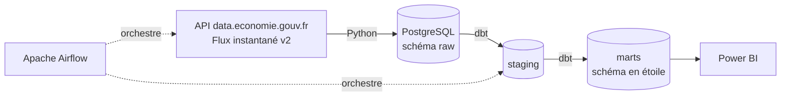

# ⛽ Observatoire des prix des carburants en France

Pipeline de données de bout en bout qui collecte chaque jour les prix des carburants
de l'ensemble des stations-service françaises, les stocke dans un entrepôt de données
et les restitue dans un tableau de bord Power BI.

> 🚧 Projet en cours de développement — voir la [feuille de route](#-feuille-de-route).

## 🎯 Objectifs

- Construire un pipeline **ELT automatisé et fiable** sur des données publiques réelles
- Modéliser les données en **schéma en étoile** pour l'analyse
- Répondre à des questions concrètes :
  - Quelles régions et quels départements paient leur carburant le plus cher ?
  - Quel est l'écart de prix entre la Corse et le continent ?
  - Combien coûte un plein sur autoroute par rapport à une route classique ?
  - Comment les prix évoluent-ils dans le temps ?

## 🏗️ Architecture



## 🛠️ Technologies

| Étape | Outil |
|---|---|
| Extraction & chargement | Python (pandas, requests, SQLAlchemy) |
| Entrepôt de données | PostgreSQL 16 |
| Transformation & tests qualité | dbt |
| Orchestration | Apache Airflow |
| Conteneurisation | Docker Compose |
| Visualisation | Power BI |
| Intégration continue | GitHub Actions |

## 📁 Structure du projet

```
observatoire-carburants/
├── extract/
│   └── extract_prix.py      # Extraction, transformation et chargement dans raw
├── sql/
│   └── init.sql             # Création du schéma raw
├── tests/
│   └── test_transform.py    # Tests unitaires de la transformation
├── data/raw/                # Fichiers JSON bruts horodatés (non versionnés)
├── .github/workflows/       # CI : tests automatiques à chaque push
├── docker-compose.yml
├── requirements.txt
└── .env.example
```

## 🚀 Lancer le projet

**Prérequis :** Docker et Python 3.11+

```bash
# 1. Cloner le dépôt
git clone https://github.com/MhandAMRANE/observatoire-carburants.git
cd observatoire-carburants

# 2. Configurer l'environnement
cp .env.example .env
python -m venv .venv
source .venv/bin/activate        # Windows : .venv\Scripts\activate
pip install -r requirements.txt

# 3. Démarrer PostgreSQL
docker compose up -d

# 4. Lancer l'extraction
python extract/extract_prix.py

# 5. Lancer les tests
pytest -v
```

La base est consultable sur **http://localhost:8081** (Adminer) :
système *PostgreSQL*, serveur `postgres`, identifiants du fichier `.env`.

## 🔍 Choix techniques

- **Format long** : le flux publie une colonne par carburant ; les données sont
  pivotées en une ligne par station et par carburant, plus simple à agréger et à filtrer.
- **Idempotence** : le chargement passe par des tables temporaires puis un `upsert`.
  Relancer le pipeline ne crée jamais de doublons.
- **Historisation** : la clé `(station_id, carburant, date_maj)` conserve chaque
  changement de prix, ce qui permet d'analyser l'évolution dans le temps.
- **Fichiers bruts conservés** : chaque extraction est sauvegardée telle quelle,
  ce qui permet de rejouer le pipeline en cas de bug dans la transformation.
- **Contrôles qualité** : exclusion des prix vides, nuls ou aberrants (< 0,50 € ou > 5 €).

## 🗺️ Feuille de route

- [x] Extraction Python et chargement dans PostgreSQL
- [x] Tests unitaires et intégration continue
- [ ] Modélisation dbt (staging → marts, schéma en étoile) et tests de qualité
- [ ] Orchestration quotidienne avec Airflow
- [ ] Tableau de bord Power BI
- [ ] Analyse des résultats et principaux enseignements
- [ ] Bonus : prévision des prix

## 📊 Source des données

[Prix des carburants en France — Flux instantané v2](https://www.data.gouv.fr/fr/datasets/6407d088d4e23dc662022e2c),
publié par le ministère de l'Économie sous Licence Ouverte. Données mises à jour toutes les 10 minutes.

## 👤 Auteur

**M'hand Amrane** — Étudiant en Master Data Engineering, Université de Corse
[GitHub](https://github.com/MhandAMRANE)
